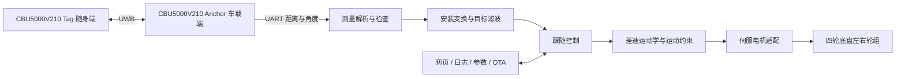

# 基于UWB的智能跟随四轮车的系统架构方案

基于 **CBU5000V210 UWB 双端固件 + ESP32 主控 + 速度模式伺服电机**的模块化跟随系统。项目覆盖目标测距测角、数据滤波、跟随决策、差速运动学、电驱适配、网页诊断、运行日志与 OTA。

车辆几何、运动能力和电机安装独立配置；跟随控制使用 `cm/s`、`deg/s`，驱动接口使用逻辑轮速 `rpm`。通过参数和驱动适配迁移到同类差速底盘，无需修改整套控制算法。

> **版本状态：v0.1.0，工程整理与控制重构版本。** UWB 双端保留原工程实现，ESP32 重构为物理单位控制链路；该版本已进行软件验证，车辆闭环效果、网络交互和电驱联调仍需按[验证记录](docs/验证记录与已知限制.md)完成实车验收。

## 系统架构



车载 Anchor 直接接入 ESP32。当前支持左右轮组差速结构，轮组可由两个驱动电机配合从动轮构成，也可配置四个独立电机按左右分组执行。具体配置须与真实底盘一致。

## 功能与边界

| 模块 | 实现内容 |
| --- | --- |
| UWB 双端 | Tag / Anchor 独立 Keil 工程，共用 SDK，车载端输出文本测量帧 |
| 目标处理 | 帧格式、有限数值、范围、一致性、跳变与超时检查；安装坐标变换；四状态 Kalman 滤波 |
| 跟随控制 | 距离比例控制、转向死区、近目标停车滞回、大角度前进弧线 |
| 底盘适配 | 轮距、轮径、有效轮距系数、速度/角速度/转弯半径约束 |
| 电驱 | 通用逻辑轮速接口；微雪 Waveshare DDSM Driver HAT（A）参考协议适配 |
| 运行保护 | 上电停止、显式使能、测量超时停车、调度超时撤销使能、OTA 停车 |
| 调试维护 | 网页状态、USB 日志、256 帧 CSV、目标距离持久化、密码 OTA |

本版本为前向纯跟随：不接入避障传感器，不执行倒车、地图规划或自主搜索。车体尺寸提供几何描述和旋转包络，环境碰撞判断不属于本版本功能。

## 工程结构

```text
firmware/
├─ uwb_cbu5000v210/      Tag、Anchor、共享 SDK、Keil 构建脚本
└─ esp32/
   ├─ config/           车辆、跟随、板级与本地网络配置
   ├─ lib/follow_core/  与 Arduino 无关的测量和控制模块
   └─ src/              电驱、应用调度、网页、参数存储、网络与 OTA
docs/                   模块设计、调试和验证文档
hardware/               接线与机械配置
examples/               标明用途的协议与数据样例
tests/                  实际控制代码的主机回归测试
tools/                  构建检查与日志分析
```

## 构建与运行

ESP32 使用 Python 3.12、PlatformIO，平台版本锁定为 `espressif32@7.0.1`：

```powershell
python -m pip install platformio==6.1.19
pio run -d firmware/esp32 -e esp32dev
```

根据底盘修改 [vehicle_config.h](firmware/esp32/config/vehicle_config.h) 与 [board_config.h](firmware/esp32/config/board_config.h)。需要网络功能时，把 `local_config.example.h` 复制为同目录的 `local_config.h`，填写 Wi-Fi、独立控制令牌和 OTA 密码。令牌、OTA 密码各至少 16 字符；空 Wi-Fi 配置允许离线运行，空 OTA 密码关闭网络升级。

首次 USB 写入：

```powershell
pio run -d firmware/esp32 -e esp32dev -t upload --upload-port COM5
pio device monitor -d firmware/esp32 -e esp32dev --port COM5
```

`COM5` 替换为实际串口。固件上电保持停止；USB 串口发送以换行结束的 `arm` / `stop`，或连接同一网络，在设备 IP 的网页中输入控制令牌后操作。先完成[接线与方向检查](hardware/接线与安装.md)，再使能跟随。

UWB 双端在 Windows + Keil MDK / ARM Compiler 6 环境构建：

```powershell
cd firmware/uwb_cbu5000v210
powershell -ExecutionPolicy Bypass -File .\build_all.ps1
```

详见 [UWB 固件设计](docs/UWB双端固件设计.md)与[调试与参数整定](docs/调试与参数整定.md)。

## 设计文档

- [系统架构与模块边界](docs/系统架构.md)
- [车辆参数与底盘适配](docs/车辆参数与底盘适配.md)
- [UWB 双端固件设计](docs/UWB双端固件设计.md)
- [目标数据处理](docs/目标数据处理.md)
- [跟随控制设计](docs/跟随控制设计.md)
- [底盘运动学与电驱适配](docs/底盘运动学与电驱适配.md)
- [运行状态与保护机制](docs/运行状态与保护机制.md)
- [网页、日志、参数与 OTA](docs/网页日志参数与OTA.md)
- [调试与参数整定](docs/调试与参数整定.md)
- [验证记录与已知限制](docs/验证记录与已知限制.md)

## 本地检查

```powershell
python tools/test_core.py
python tools/check_repository.py
```

主机测试执行与 ESP32 相同的 C/C++ 控制源文件，覆盖异常串口帧、坐标变换、转向符号、几何参数变化、限速、启动、失联、OTA 状态和计时回绕。GitHub Actions 配置包含主机测试与 ESP32 构建；UWB 需要单独的 Keil 环境。

## 开源与依赖

项目自有代码与文档使用 [Apache-2.0](LICENSE)。厂商 SDK、预编译库及内嵌第三方组件保留原许可和版权声明；第三方实现的源码可用范围见 [THIRD_PARTY_NOTICES.md](THIRD_PARTY_NOTICES.md)。本仓库以独立历史发布，不包含个人网络配置或原私有仓库历史。
