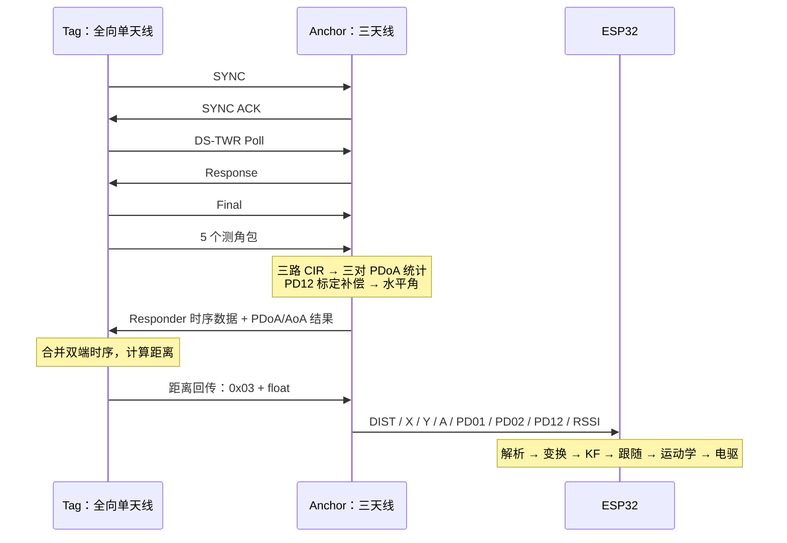

# 从射频测量到电机指令的数据链路

本文以一次正常交互为主线，连接 UWB 天线、射频测量、异常处理、目标跟踪与车辆控制。原理分别见[天线与测距测角](天线选型与测距测角原理.md)、[Kalman 滤波设计](Kalman滤波设计与参数整定.md)。

## 1. 一次完整无线周期



源码中 Tag 的结果接收 case 位置不按协议阶段顺序排列，应根据状态跳转和 IRQ 处理理解流程，不能仅按源文件从上向下猜测时序。

目标循环周期设为约 50 ms。单轮正常处理时间、等待和异常重试都会影响有效输出间隔，不能将配置周期直接等同于始终稳定的实测帧率。

## 2. Anchor 为什么先收 5 个包

当前 Tag 的 `DEF_NUMBER_OF_PDOA_REPEATED_TX=5`，Anchor 的接收数来自 `DEF_PDOA_NUMPKT_SUPERFRAME_MAX=5`，双端必须匹配。

测角阶段 Anchor 使用之前获得的增益和 CFO 估计设置接收参数，开启全部接收通道。只有 RX0、RX1、RX2 的相关接收事件都达到本轮要求，才保存这一包的 CIR 数据并进入下一包。超出接收等待窗口会结束本轮，不应将缺失通道当成零相位。

CIR 是接收信道冲激响应，包含到达路径的幅度与相位信息。framework 将多通道 CIR 交给厂商处理接口，得到每包的接收相位，再形成三对 PDoA。其内部相位提取方法封装在库中，不能仅凭函数名断言采用了哪一种首径选择或去多径算法。

每对相位差都会计算均值和中值，当前 App 取 `median.rx1_rx2`。5 包中值能够降低少数离群包对结果的影响，但不是无限抗异常；连续受污染、相位跨界或系统性偏差仍可能产生错误角度。

## 3. Anchor 已经做了哪些处理

| 层次 | 当前实现 | 设计目的与边界 |
| --- | --- | --- |
| 包内统计 | 5 包相位均值与普通中值 | 抑制少数异常包；没有圆周中值 |
| 相位标定 | PD12 减偏置、周期折返 | 修正参考相位零点，保持周期范围 |
| 几何反解 | 波长/基线换算、asin 定义域限幅 | 得到所选基线方向角；不是质量判定 |
| 跨周期跳变保持 | 与最近接受角度差超过 60° 时，最多保持旧值 2 次 | 降低孤立大跳变对控制的冲击 |
| 输出坐标 | `X=DIST×sin(A)`、`Y=DIST×cos(A)` | 为当前平面跟随提供等效坐标 |

在理想 50 ms 周期且每轮成功的条件下，两次保持约对应 100 ms；实际延迟以成功输出周期为准。持续的大变化到第三次候选时可以被接受，但实现没有额外验证这些候选是否彼此一致，不能称为“三帧一致性确认”。

`PD01/PD02/PD12` 输出的是 SDK 相位统计值；A 已经过 PD12 偏置补偿、几何解算和跳变保持。因此同一日志行的 A 未必严格对应这一行 PD12 的即时反解值。

Anchor 日志附近保留了旧注释“直接输出、不做滤波”。准确含义只能是该打印位置没有额外执行跟踪平滑；上游确实存在中值和跳变保持。当前主要时间跟踪由 ESP32 KF 完成。

## 4. 距离为什么先由 Tag 算，再发回 Anchor

DS-TWR 需要双端记录的时间间隔。当前 Anchor 将自己的时序和 PDoA/AoA 结果发送给 Tag，Tag 合并本端时序后调用距离计算接口，再将距离回传车端。Anchor 收到合法的距离结果后，才输出本轮组合数据。

距离回传载荷为 1 字节标记 `0x03` 加一个直接内存复制的 4 字节 float。当前是同系列固件间使用的内部格式，没有在该载荷中定义跨平台字节序或独立协议版本。接入其他 UWB 端或重新实现协议时，应单独定义这些边界。

## 5. ESP32 接收到的“原始值”有多原始

```text
射频 CIR 数据
    → 每包接收相位 / PDoA
    → Anchor 相位统计、补偿、角度解算与保持
    → UART 测量：ESP32 的 raw 字段
    → 车体安装变换、工作区检查
    → 四状态 KF：ESP32 的 filtered 字段
```

网页中的 raw 表示“进入 ESP32 跟踪前的测量”，不是 ADC 原始采样，也不是未处理 PDoA。这样定义有利于现场调试，但必须说明它已包含 UWB 侧处理。

同样，ESP32 的新 `sequence` 说明收到了一个新的有效串口帧，不证明其中的角度一定来自本轮新接受的角度候选；Anchor 的保持值没有通过独立标志暴露给 ESP32。若要分析这个保持过程，需要同时看 PDoA 与角度日志，或增加 UWB 侧诊断。

## 6. 接收检查、工作区、KF 与停车各解决什么

| 顺序 | 层 | 问题 | 失败/异常时行为 |
| --- | --- | --- | --- |
| 1 | UART 解析 | 帧坏、数值非法、明显跳变 | 拒绝新帧，不刷新最近有效时间 |
| 2 | 数据时效 | 只有旧值，没有新有效测量 | 超过默认 300 ms，清空目标并停车 |
| 3 | 安装坐标变换 | Anchor 和车体参考点不同 | 应用固定旋转和平移 |
| 4 | 前方工作区 | 目标不在可用跟随方向 | 目标无效、复位 KF、停车 |
| 5 | KF 创新门控 | 新观测与当前预测显著不符 | 暂不普通修正，连续拒绝后重播种 |
| 6 | 跟随/运动保护 | 过近、未使能、升级、调度异常 | 统一停止路径 |

解析器的距离/XY 一致性主要检查文本组合是否合理。因为本版 Anchor 的 X/Y 本身就由 DIST/A 生成，它不是独立传感器交叉验证，不能证明无线测量正确。

## 7. 一组数据怎样变成左右轮请求

以下仅是计算示例，假设安装偏移为零、滤波已稳定、目标在前方左侧：

```text
DIST = 200 cm，A = +30°
X ≈ +100 cm，Y ≈ +173.2 cm
目标距离 = 120 cm
距离误差 = 80 cm
未接受后续约束前的巡航请求 = 0.7 × 80 = 56 cm/s
角度超过 3° 死区，产生正的向左角速度请求
```

之后依次接受角度相关的前进衰减、弧线半径约束、差速运动学、最大轮速同比例缩放、正常加减速限制，再转换成驱动协议。向左为正，所以物理右轮请求高于左轮；电机安装的正反向由驱动配置处理。

不能把 56 cm/s 直接当成本例最终车速，因为它只是控制链中间量；也不能把驱动下发 RPM 当成实际编码器反馈。

## 8. 推荐保留的调试证据

- 射频与几何：PD12、补偿值、A、信道、基线与安装方式。
- UART：有效帧数、拒绝原因、最近有效时间和新帧序号。
- 跟踪：原始/滤波角距、实际周期；深度诊断时增加 NIS、P、KF 拒绝计数。
- 控制：运行状态、前进/角速度请求、左右轮逻辑下发值。
- 实车：外部测得的距离、方向、轨迹或轮速，明确负载和地面条件。

其中补偿值、NIS、P 和 KF 拒绝计数尚未直接出现在当前网页/CSV 中；这是一份诊断需求清单，不是已实现字段清单。增加说明时应始终让“建议观测”与“当前实际导出”对应清楚。
